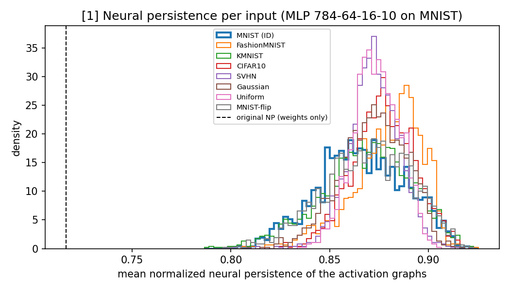
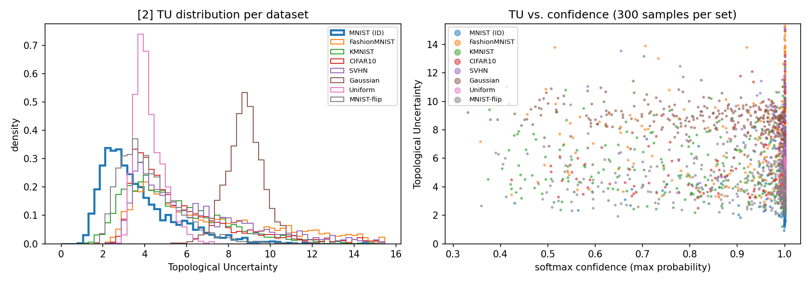
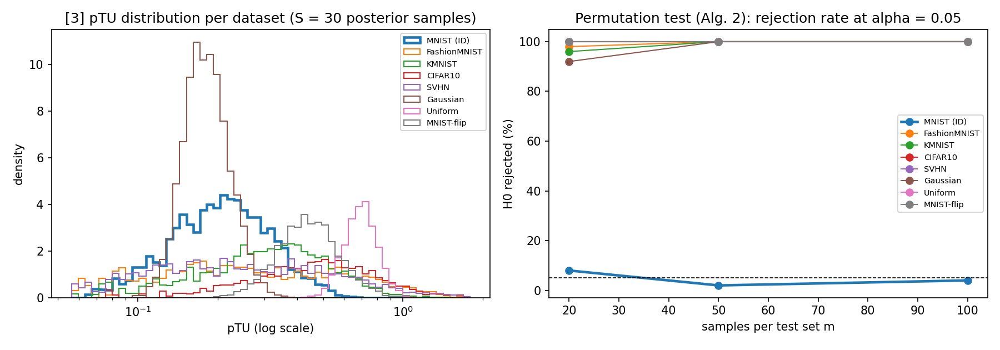
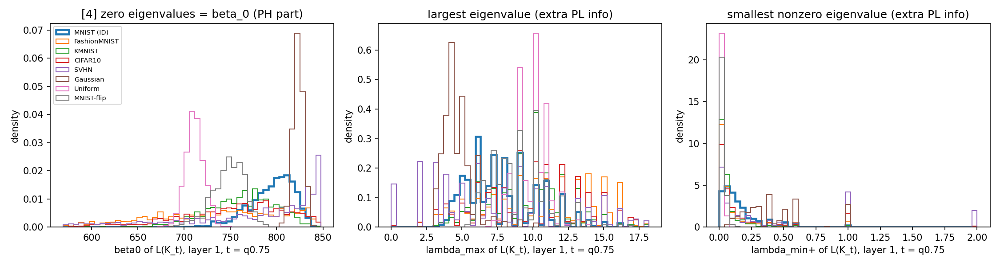

# OOD detection with topology of neural-network layers

Implements the six approaches from `Topology_NN_Layers_Report` on **one shared model** and
evaluates each for out-of-distribution (OOD) detection. Methods are added one at a time.

## Shared model

Bayesian MLP **784 → 64 → 16 → 10** (ReLU) trained with Bayes-by-Backprop on MNIST: the exact
architecture and prior (scale mixture, σ₁ = 1, σ₂ = 0.007) of the pTU paper [3]. MLPs on MNIST
are also the setting of [1] and [2].

- Test accuracy: **97.1 %** (posterior mean), 97.1 % (30-sample average). The paper reports 97.39 %.
- The KL term is scaled by 0.1. With the full KL the model stalls at 94.5 %; the paper does not
  say how it weights the KL.
- Early stopping with patience 25, as in the paper. Weights: `cache/bnn_seed0.pt`.
- Deterministic methods ([1], [2], [4], [5], [6]) use the posterior-mean weights; pTU [3] uses
  posterior samples.

## Evaluation protocol

- In-distribution (ID): 2000 MNIST test images. Reference statistics: 10 000 MNIST train images.
- OOD sets (2000 each, all grayscale 28×28 in [0, 1], pTU preprocessing): Fashion-MNIST,
  KMNIST, CIFAR-10, SVHN, Gaussian noise, Uniform noise (as in [2]), and MNIST-flip (MNIST with
  100 random pixels flipped, x → 1 − x: the corruption shift of [2] §4.3).
- Metrics: AUROC (OOD = positive) and FPR95 = % of OOD accepted as ID at the threshold that
  accepts 95 % of ID samples. Baseline: MSP (1 − max softmax), the baseline used in [2].

## Results

### [1] Neural Persistence (Rieck et al., 2019): `m1_neural_persistence.py`

- **(a) Original NP** is computed from the weights alone (normalized by the global max weight,
  0-dim superlevel PD = MST, p = 2, normalized by the Theorem 1 bound, averaged over layers).
  Network NP = **0.716** (layers: 0.786 / 0.705 / 0.658). It does not depend on the input, so
  every sample gets the same score: **AUROC = 50 on every OOD set**. It cannot detect OOD.
- **(b) Input NP (our adaptation)** applies the same NP formula to each input's activation graph
  |W(j,i)·x(i)| (the graph of [2]). Score = |NP(x) − μₖ| / σₖ, using the training NP statistics
  of the predicted class k.

| OOD set | mean NP | NP AUROC ↑ | NP FPR95 ↓ | raw NP AUROC ↑ | MSP AUROC ↑ | MSP FPR95 ↓ |
|---|---|---|---|---|---|---|
| MNIST (ID) | 0.866 | – | – | – | – | – |
| Fashion-MNIST | 0.879 | 50.0 | 96.5 | 68.2 | 68.2 | 80.7 |
| KMNIST | 0.868 | 59.6 | 84.2 | 53.2 | 84.2 | 60.4 |
| CIFAR-10 | 0.877 | 48.0 | 95.4 | 65.0 | 62.5 | 84.9 |
| SVHN | 0.872 | 41.8 | 98.0 | 59.4 | 53.1 | 95.0 |
| Gaussian | 0.872 | 51.8 | 93.3 | 58.2 | 92.8 | 58.7 |
| Uniform | 0.874 | 40.4 | 99.2 | 61.1 | 43.1 | 99.6 |
| MNIST-flip | 0.869 | 57.0 | 89.4 | 54.2 | 80.2 | 67.5 |
| **average** | | **49.8** | **93.7** | **59.9** | **69.2** | **78.1** |

"raw NP" is a diagnostic one-sided score (higher NP = more OOD).

**Takeaways for [1]:**
- NP was designed to describe a *trained network*, not an *input*. In its original form it
  carries no per-sample information.
- Applied per input, NP distributions of ID and OOD data overlap almost completely: OOD inputs
  have only slightly higher NP (0.868–0.879 vs 0.866). The class-conditional score is at chance
  (49.8), and the one-sided score reaches only 59.9, below the MSP baseline (69.2).
- Why: NP compresses each layer's whole PD into one normalized number. The global-max
  normalization also removes the activation scale, which is exactly where OOD inputs differ.
  This motivates [2], which keeps the full PD and compares it with class-wise reference PDs.

### [2] Topological Uncertainty (Lacombe et al., 2021): `m2_topological_uncertainty.py`

For each input, the 0-dim PD of every layer's activation graph |W(j,i)·x(i)| (= the
d_l + d_{l+1} − 1 MST weights) is compared, by 2-Wasserstein distance (L2 between sorted
weights), with the Fréchet-mean PD of the training inputs that have the same predicted class.
TU = average over the 3 layers. Class means come from 10 000 MNIST training images.

| OOD set | mean TU | mean conf. | **TU AUROC ↑** | TU FPR95 ↓ | TU-norm AUROC ↑ | TU-norm FPR95 ↓ | L1 / L2 / L3 AUROC | MSP AUROC ↑ | MSP FPR95 ↓ |
|---|---|---|---|---|---|---|---|---|---|
| MNIST (ID) | 3.67 | 0.979 | – | – | – | – | – | – | – |
| Fashion-MNIST | 6.98 | 0.924 | 83.3 | 61.3 | 90.0 | 51.3 | 91.3 / 73.4 / 73.9 | 68.2 | 80.7 |
| KMNIST | 5.36 | 0.844 | 73.4 | 79.9 | 75.9 | 80.8 | 72.9 / 62.8 / 69.9 | 84.2 | 60.4 |
| CIFAR-10 | 5.88 | 0.942 | 78.6 | 78.2 | 92.7 | 56.6 | 99.4 / 58.8 / 60.3 | 62.5 | 84.9 |
| SVHN | 6.47 | 0.978 | 82.2 | 69.3 | 94.4 | 46.7 | 99.6 / 65.2 / 64.6 | 53.1 | 95.0 |
| Gaussian | 8.79 | 0.837 | 97.8 | 4.2 | 96.6 | 14.1 | 86.5 / 94.7 / 97.9 | 92.8 | 58.7 |
| Uniform | 4.21 | 0.997 | 69.3 | 100.0 | 93.0 | 78.8 | 100.0 / 44.0 / 33.8 | 43.1 | 99.6 |
| MNIST-flip | 4.21 | 0.873 | 64.1 | 96.4 | 73.9 | 95.5 | 83.8 / 52.2 / 56.2 | 80.2 | 67.5 |
| **average** | | | **78.4** | **69.9** | **88.1** | **60.5** | 90.5 / 64.5 / 65.3 | **69.2** | **78.1** |

- **TU** is the paper's definition: raw distances averaged over layers.
- **TU-norm** is a diagnostic: each layer's distance is divided by its mean on the training set
  before averaging, so all layers count equally.
- **L1 / L2 / L3** is the AUROC of each layer's distance used alone.

**Takeaways for [2]:**
- TU beats the confidence baseline on average (**78.4 vs 69.2 AUROC**) and on 5 of 7 OOD sets.
- It reproduces the paper's main claim. SVHN (conf. 0.978), Uniform (0.997) and CIFAR-10
  (0.942) are classified about as confidently as MNIST (0.979), so MSP almost fails
  (AUROC 53 / 43 / 62), while TU still separates them (82 / 69 / 79). See the right panel.
- KMNIST and MNIST-flip are the only sets where MSP wins. Both are digit-like "near-OOD"
  inputs that activate the network much like MNIST does.
- **Layer averaging matters.** Layer 1 alone gives 90.5 average AUROC. The plain average
  over layers lets the larger-scale distances dominate, which costs about 10 points (TU 78.4 vs
  TU-norm 88.1). The paper's open question "richer descriptors than MST" applies; how the
  layers are combined matters just as much.
- Limitation, as in the paper: an OOD input is compared with the mean of its *predicted*
  class, so a wrong prediction means a wrong reference diagram.

### [3] pTU: predictive Topological Uncertainty (Yeh & Yang, 2025): `m3_ptu.py`

- **Score:** S = 30 weight samples are drawn from the Bayes-by-Backprop posterior (the same 30
  for every input). For each input and layer, I take the 0-dim activation-graph PD (as in [2]) under every
  sample. pTU = the Fréchet variance of those 30 PDs, averaged over the 3 layers (Def. 3.1).
  With 1-D diagrams of equal size, the Fréchet mean is the coordinate-wise mean of the sorted
  weights.
- **Bayesian baselines** use the same 30 samples: mutual information (MI, epistemic
  uncertainty), predictive entropy, and MSP of the averaged prediction.
- **Reference distribution:** pTU of 2000 MNIST training images.

**(a) Per-sample OOD detection (AUROC ↑ / FPR95 ↓)**

| OOD set | mean pTU | **pTU** | MI | Entropy | MSP (BMA) | pTU L1 / L2 / L3 AUROC |
|---|---|---|---|---|---|---|
| MNIST (ID) | 0.262 | – | – | – | – | – |
| Fashion-MNIST | 0.579 | 78.4 / 42.3 | 73.5 / 75.6 | 69.5 / 79.3 | 69.6 / 79.3 | 89.8 / 73.3 / 77.8 |
| KMNIST | 0.437 | 77.8 / 61.5 | 87.1 / 50.1 | 84.8 / 57.1 | 84.7 / 58.6 | 94.1 / 72.6 / 76.1 |
| CIFAR-10 | 0.677 | 91.9 / 28.2 | 70.6 / 73.9 | 64.5 / 82.7 | 64.7 / 83.0 | 87.6 / 77.8 / 93.1 |
| SVHN | 0.551 | 75.7 / 49.4 | 58.9 / 93.3 | 54.6 / 94.3 | 54.7 / 94.4 | 70.9 / 58.6 / 78.2 |
| Gaussian | **0.193** | **28.5** / 100.0 | 92.4 / 58.6 | 93.2 / 53.4 | 92.9 / 57.4 | 86.5 / 10.0 / 30.8 |
| Uniform | 0.714 | 99.8 / 0.2 | 55.8 / 97.5 | 46.4 / 99.5 | 46.6 / 99.5 | 99.1 / 88.9 / 99.9 |
| MNIST-flip | 0.486 | 91.8 / 48.0 | 84.6 / 52.6 | 80.8 / 64.7 | 80.8 / 65.6 | 98.1 / 77.2 / 91.4 |
| **average** | | **77.7 / 47.1** | 74.7 / 71.7 | 70.6 / 75.9 | 70.6 / 76.8 | 89.4 / 65.5 / 78.2 |

**(b) Paper's dataset-level test (Algorithm 2).** I draw m training and m test inputs and run a
permutation test (1000 permutations) on the W1 distance between their pTU values, repeated 50
times. Entries are the % of repeats where H0 ("same distribution") is rejected at α = 0.05.

| Test set | m = 20 | m = 50 | m = 100 |
|---|---|---|---|
| MNIST test (ID: should be about 5 %) | 8 % | 2 % | 4 % |
| Fashion-MNIST | 98 % | 100 % | 100 % |
| KMNIST | 96 % | 100 % | 100 % |
| CIFAR-10 | 100 % | 100 % | 100 % |
| SVHN | 100 % | 100 % | 100 % |
| Gaussian | 92 % | 100 % | 100 % |
| Uniform | 100 % | 100 % | 100 % |
| MNIST-flip | 100 % | 100 % | 100 % |

**Takeaways for [3]:**
- **The dataset-level test works very well.** With only 50 test images it flags every OOD set
  in 100 % of repeats. On ID data the false-alarm rate stays near the nominal 5 % (2–8 %).
  This is the setting the paper proposes, and it reproduces the paper's Table 1 (MNIST row:
  every OOD set p ≈ 0.001, MNIST p = 0.95).
- **Per sample, pTU (77.7) beats every Bayesian baseline** (MI 74.7, entropy 70.6), and it
  gives the best result so far on the hardest high-confidence sets: Uniform 99.8, CIFAR-10 91.9,
  MNIST-flip 91.8.
- **Weakness: pTU is not one-directional.** Gaussian noise gets *lower* pTU than MNIST (0.193 vs
  0.262, AUROC 28.5), and parts of SVHN and Fashion-MNIST sit in a low-pTU tail (left panel).
  A one-sided "high pTU = OOD" rule misses these inputs. The permutation test compares whole
  distributions, so it still catches them. A likely cause: on Gaussian inputs most hidden units
  are inactive, so the activation graphs (and their variance across weight samples) shrink.
- As in [2], **layer 1 alone is the strongest** (89.4 average AUROC), and averaging over layers
  dilutes it.
- Compared with [2], pTU needs 30 forward passes per input but no class-conditional
  reference, so it does not depend on the prediction being correct.

### [4] Persistent Laplacian (Wolf et al., 2025; PETLS; Botnan & Dong): `m4_persistent_laplacian.py`

**Reduction.** Each layer's activation graph |W(j,i)·x(i)| from [2] is filtered by superlevel
sets: K_t = all neurons + the edges with weight ≥ t. Every vertex exists from the start, so for
K_s ⊆ K_t the 0-dim persistent Laplacian is Δ₀^{K_s,K_t} = Δ₀,up = **L(K_t), the ordinary graph
Laplacian** (the down part is 0 in dimension 0). A bipartite graph has no triangles, so dimension
0 is the only non-trivial one (as the report notes). Hence:
- **zero eigenvalues** of L(K_t) = β₀(K_t), the persistent Betti number. This is the same
  information as the PD of [1]–[3], read at fixed thresholds (a Betti curve);
- **nonzero eigenvalues** = what the persistent Laplacian adds on top of PH.

**Features.**
- Thresholds: 3 per layer, the 50/75/90 % quantiles of the nonzero training MST weights of
  that layer (most layer-1 weights are 0 because of black pixels, which made the first
  threshold 0 and the graph complete).
- At each threshold: β₀, number of edges (= trace/2), smallest nonzero eigenvalue, largest
  eigenvalue, and std of the nonzero eigenvalues.
- Score = mean squared z-score against training inputs of the same predicted class (as in TU).
- Isolated vertices are counted directly and removed before the eigendecomposition.
- Evaluated on the first 1000 images of each set; TU and MSP are recomputed on the same 1000.

| OOD set | **PL full** | β₀ only (PH part) | nonzero spectrum only | TU [2] | MSP | PL-full L1 / L2 / L3 |
|---|---|---|---|---|---|---|
| Fashion-MNIST | 82.3 / 51.1 | 86.2 / 46.4 | 80.1 / 54.8 | 84.9 / 56.4 | 67.5 / 81.5 | 82.4 / 76.5 / 69.8 |
| KMNIST | 76.3 / 72.4 | 79.2 / 66.4 | 74.7 / 75.4 | 75.6 / 76.1 | 83.8 / 59.8 | 72.0 / 65.0 / 65.0 |
| CIFAR-10 | 73.5 / 67.5 | 75.0 / 63.9 | 72.1 / 70.7 | 80.0 / 75.4 | 62.6 / 84.6 | 79.1 / 73.5 / 54.6 |
| SVHN | 83.9 / 46.4 | 83.5 / 51.0 | 83.0 / 48.3 | 82.9 / 66.0 | 53.4 / 94.4 | 88.6 / 80.9 / 61.6 |
| Gaussian | 99.1 / 2.0 | 99.2 / 1.1 | 98.9 / 4.0 | 98.1 / 2.4 | 92.6 / 57.7 | 92.6 / 98.9 / 97.6 |
| Uniform | 85.1 / 96.3 | 96.2 / 26.8 | 76.2 / 99.6 | 70.9 / 99.8 | 43.1 / 99.6 | 95.4 / 69.8 / 25.0 |
| MNIST-flip | 71.7 / 91.2 | 81.5 / 82.5 | 66.9 / 93.7 | 64.8 / 96.2 | 80.0 / 69.2 | 76.7 / 57.7 / 50.2 |
| **average** | **81.7 / 61.0** | **85.8 / 48.3** | 78.8 / 63.8 | 79.6 / 67.5 | 69.0 / 78.1 | 83.8 / 74.6 / 60.5 |

(Entries: AUROC ↑ / FPR95 ↓.)

**Takeaways for [4]:**
- **The full persistent-Laplacian score beats TU and MSP** (81.7 vs 79.6 and 69.0 AUROC on the
  same images).
- **The gain comes from the harmonic (PH) part, not the extra eigenvalues.** β₀ alone gives
  85.8, the best single-sample score so far, with the lowest FPR95 (48.3). Adding the nonzero
  eigenvalues *lowers* it to 81.7, and they score only 78.8 on their own.
- Why: the threshold graphs are small and unweighted, so their nonzero eigenvalues take a few
  discrete values (the spiky middle and right panels). This adds noise rather than signal.
  The "extra geometry" of the persistent Laplacian does not pay off on these graphs.
- **β₀ at fixed thresholds beats TU's Wasserstein distance** (85.8 vs 79.6), most clearly on
  Uniform (96.2 vs 70.9) and MNIST-flip (81.5 vs 64.8). Both use the same PD. The difference is
  that TU compares PDs after sorting, while a Betti curve at fixed thresholds keeps the absolute
  scale and is z-scored per threshold, so every layer and threshold counts equally (compare
  the TU-norm result in [2]).
- On these graphs, the theory papers' main points (stability of the up/down Laplacians, fast
  algorithms for non-branching complexes) do not matter: in dimension 0 the persistent
  Laplacian is just a graph Laplacian, and one eigendecomposition per graph takes 48 s for
  all 10 000 inputs.
