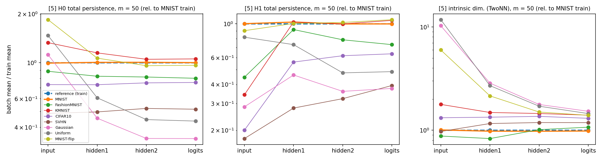
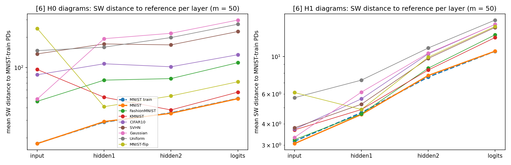
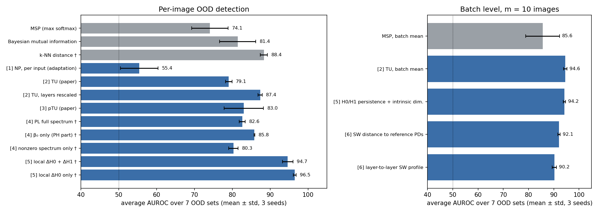

# OOD detection with topology of neural-network layers

Implements the six approaches from `Topology_NN_Layers_Report` on **one shared model** and
evaluates each for out-of-distribution (OOD) detection. Methods are added one at a time.

## Shared model

Bayesian MLP **784 → 64 → 16 → 10** (ReLU) trained with Bayes-by-Backprop on MNIST: the exact
architecture and prior (scale mixture, σ₁ = 1, σ₂ = 0.007) of the pTU paper [3]. MLPs on MNIST
are also the setting of [1] and [2].

- Test accuracy: **97.1 %** (posterior mean), 97.1 % (30-sample average). The paper reports 97.39 %.
- The KL term is scaled by 0.1. With the full KL the model stalls at 94.5 %; the paper does not
  say how it weights the KL.
- Early stopping with patience 25, as in the paper. Weights: `cache/bnn_seed0.pt`.
- Deterministic methods ([1], [2], [4], [5], [6]) use the posterior-mean weights; pTU [3] uses
  posterior samples.

## Evaluation protocol

- In-distribution (ID): 2000 MNIST test images. Reference statistics: 10 000 MNIST train images.
- OOD sets (2000 each, all grayscale 28×28 in [0, 1], pTU preprocessing): Fashion-MNIST,
  KMNIST, CIFAR-10, SVHN, Gaussian noise, Uniform noise (as in [2]), and MNIST-flip (MNIST with
  100 random pixels flipped, x → 1 − x: the corruption shift of [2] §4.3).
- Metrics: AUROC (OOD = positive) and FPR95 = % of OOD accepted as ID at the threshold that
  accepts 95 % of ID samples. Baseline: MSP (1 − max softmax), the baseline used in [2].

## Results

### [1] Neural Persistence (Rieck et al., 2019): `m1_neural_persistence.py`

- **(a) Original NP** is computed from the weights alone (normalized by the global max weight,
  0-dim superlevel PD = MST, p = 2, normalized by the Theorem 1 bound, averaged over layers).
  Network NP = **0.716** (layers: 0.786 / 0.705 / 0.658). It does not depend on the input, so
  every sample gets the same score: **AUROC = 50 on every OOD set**. It cannot detect OOD.
- **(b) Input NP (our adaptation)** applies the same NP formula to each input's activation graph
  |W(j,i)·x(i)| (the graph of [2]). Score = |NP(x) − μₖ| / σₖ, using the training NP statistics
  of the predicted class k.

| OOD set | mean NP | NP AUROC ↑ | NP FPR95 ↓ | raw NP AUROC ↑ | MSP AUROC ↑ | MSP FPR95 ↓ |
|---|---|---|---|---|---|---|
| MNIST (ID) | 0.866 | – | – | – | – | – |
| Fashion-MNIST | 0.879 | 50.0 | 96.5 | 68.2 | 68.2 | 80.7 |
| KMNIST | 0.868 | 59.6 | 84.2 | 53.2 | 84.2 | 60.4 |
| CIFAR-10 | 0.877 | 48.0 | 95.4 | 65.0 | 62.5 | 84.9 |
| SVHN | 0.872 | 41.8 | 98.0 | 59.4 | 53.1 | 95.0 |
| Gaussian | 0.872 | 51.8 | 93.3 | 58.2 | 92.8 | 58.7 |
| Uniform | 0.874 | 40.4 | 99.2 | 61.1 | 43.1 | 99.6 |
| MNIST-flip | 0.869 | 57.0 | 89.4 | 54.2 | 80.2 | 67.5 |
| **average** | | **49.8** | **93.7** | **59.9** | **69.2** | **78.1** |

"raw NP" is a diagnostic one-sided score (higher NP = more OOD).

**Takeaways for [1]:**
- NP was designed to describe a *trained network*, not an *input*. In its original form it
  carries no per-sample information.
- Applied per input, NP distributions of ID and OOD data overlap almost completely: OOD inputs
  have only slightly higher NP (0.868–0.879 vs 0.866). The class-conditional score is at chance
  (49.8), and the one-sided score reaches only 59.9, below the MSP baseline (69.2).
- Why: NP compresses each layer's whole PD into one normalized number. The global-max
  normalization also removes the activation scale, which is exactly where OOD inputs differ.
  This motivates [2], which keeps the full PD and compares it with class-wise reference PDs.

### [2] Topological Uncertainty (Lacombe et al., 2021): `m2_topological_uncertainty.py`

For each input, the 0-dim PD of every layer's activation graph |W(j,i)·x(i)| (= the
d_l + d_{l+1} − 1 MST weights) is compared, by 2-Wasserstein distance (L2 between sorted
weights), with the Fréchet-mean PD of the training inputs that have the same predicted class.
TU = average over the 3 layers. Class means come from 10 000 MNIST training images.

| OOD set | mean TU | mean conf. | **TU AUROC ↑** | TU FPR95 ↓ | TU-norm AUROC ↑ | TU-norm FPR95 ↓ | L1 / L2 / L3 AUROC | MSP AUROC ↑ | MSP FPR95 ↓ |
|---|---|---|---|---|---|---|---|---|---|
| MNIST (ID) | 3.67 | 0.979 | – | – | – | – | – | – | – |
| Fashion-MNIST | 6.98 | 0.924 | 83.3 | 61.3 | 90.0 | 51.3 | 91.3 / 73.4 / 73.9 | 68.2 | 80.7 |
| KMNIST | 5.36 | 0.844 | 73.4 | 79.9 | 75.9 | 80.8 | 72.9 / 62.8 / 69.9 | 84.2 | 60.4 |
| CIFAR-10 | 5.88 | 0.942 | 78.6 | 78.2 | 92.7 | 56.6 | 99.4 / 58.8 / 60.3 | 62.5 | 84.9 |
| SVHN | 6.47 | 0.978 | 82.2 | 69.3 | 94.4 | 46.7 | 99.6 / 65.2 / 64.6 | 53.1 | 95.0 |
| Gaussian | 8.79 | 0.837 | 97.8 | 4.2 | 96.6 | 14.1 | 86.5 / 94.7 / 97.9 | 92.8 | 58.7 |
| Uniform | 4.21 | 0.997 | 69.3 | 100.0 | 93.0 | 78.8 | 100.0 / 44.0 / 33.8 | 43.1 | 99.6 |
| MNIST-flip | 4.21 | 0.873 | 64.1 | 96.4 | 73.9 | 95.5 | 83.8 / 52.2 / 56.2 | 80.2 | 67.5 |
| **average** | | | **78.4** | **69.9** | **88.1** | **60.5** | 90.5 / 64.5 / 65.3 | **69.2** | **78.1** |

- **TU** is the paper's definition: raw distances averaged over layers.
- **TU-norm** is a diagnostic: each layer's distance is divided by its mean on the training set
  before averaging, so all layers count equally.
- **L1 / L2 / L3** is the AUROC of each layer's distance used alone.

**Takeaways for [2]:**
- TU beats the confidence baseline on average (**78.4 vs 69.2 AUROC**) and on 5 of 7 OOD sets.
- It reproduces the paper's main claim. SVHN (conf. 0.978), Uniform (0.997) and CIFAR-10
  (0.942) are classified about as confidently as MNIST (0.979), so MSP almost fails
  (AUROC 53 / 43 / 62), while TU still separates them (82 / 69 / 79). See the right panel.
- KMNIST and MNIST-flip are the only sets where MSP wins. Both are digit-like "near-OOD"
  inputs that activate the network much like MNIST does.
- **Layer averaging matters.** Layer 1 alone gives 90.5 average AUROC. The plain average
  over layers lets the larger-scale distances dominate, which costs about 10 points (TU 78.4 vs
  TU-norm 88.1). The paper's open question "richer descriptors than MST" applies; how the
  layers are combined matters just as much.
- Limitation, as in the paper: an OOD input is compared with the mean of its *predicted*
  class, so a wrong prediction means a wrong reference diagram.

### [3] pTU: predictive Topological Uncertainty (Yeh & Yang, 2025): `m3_ptu.py`

- **Score:** S = 30 weight samples are drawn from the Bayes-by-Backprop posterior (the same 30
  for every input). For each input and layer, I take the 0-dim activation-graph PD (as in [2]) under every
  sample. pTU = the Fréchet variance of those 30 PDs, averaged over the 3 layers (Def. 3.1).
  With 1-D diagrams of equal size, the Fréchet mean is the coordinate-wise mean of the sorted
  weights.
- **Bayesian baselines** use the same 30 samples: mutual information (MI, epistemic
  uncertainty), predictive entropy, and MSP of the averaged prediction.
- **Reference distribution:** pTU of 2000 MNIST training images.

**(a) Per-sample OOD detection (AUROC ↑ / FPR95 ↓)**

| OOD set | mean pTU | **pTU** | MI | Entropy | MSP (BMA) | pTU L1 / L2 / L3 AUROC |
|---|---|---|---|---|---|---|
| MNIST (ID) | 0.262 | – | – | – | – | – |
| Fashion-MNIST | 0.579 | 78.4 / 42.3 | 73.5 / 75.6 | 69.5 / 79.3 | 69.6 / 79.3 | 89.8 / 73.3 / 77.8 |
| KMNIST | 0.437 | 77.8 / 61.5 | 87.1 / 50.1 | 84.8 / 57.1 | 84.7 / 58.6 | 94.1 / 72.6 / 76.1 |
| CIFAR-10 | 0.677 | 91.9 / 28.2 | 70.6 / 73.9 | 64.5 / 82.7 | 64.7 / 83.0 | 87.6 / 77.8 / 93.1 |
| SVHN | 0.551 | 75.7 / 49.4 | 58.9 / 93.3 | 54.6 / 94.3 | 54.7 / 94.4 | 70.9 / 58.6 / 78.2 |
| Gaussian | **0.193** | **28.5** / 100.0 | 92.4 / 58.6 | 93.2 / 53.4 | 92.9 / 57.4 | 86.5 / 10.0 / 30.8 |
| Uniform | 0.714 | 99.8 / 0.2 | 55.8 / 97.5 | 46.4 / 99.5 | 46.6 / 99.5 | 99.1 / 88.9 / 99.9 |
| MNIST-flip | 0.486 | 91.8 / 48.0 | 84.6 / 52.6 | 80.8 / 64.7 | 80.8 / 65.6 | 98.1 / 77.2 / 91.4 |
| **average** | | **77.7 / 47.1** | 74.7 / 71.7 | 70.6 / 75.9 | 70.6 / 76.8 | 89.4 / 65.5 / 78.2 |

**(b) Paper's dataset-level test (Algorithm 2).** I draw m training and m test inputs and run a
permutation test (1000 permutations) on the W1 distance between their pTU values, repeated 50
times. Entries are the % of repeats where H0 ("same distribution") is rejected at α = 0.05.

| Test set | m = 20 | m = 50 | m = 100 |
|---|---|---|---|
| MNIST test (ID: should be about 5 %) | 8 % | 2 % | 4 % |
| Fashion-MNIST | 98 % | 100 % | 100 % |
| KMNIST | 96 % | 100 % | 100 % |
| CIFAR-10 | 100 % | 100 % | 100 % |
| SVHN | 100 % | 100 % | 100 % |
| Gaussian | 92 % | 100 % | 100 % |
| Uniform | 100 % | 100 % | 100 % |
| MNIST-flip | 100 % | 100 % | 100 % |

**Takeaways for [3]:**
- **The dataset-level test works very well.** With only 50 test images it flags every OOD set
  in 100 % of repeats. On ID data the false-alarm rate stays near the nominal 5 % (2–8 %).
  This is the setting the paper proposes, and it reproduces the paper's Table 1 (MNIST row:
  every OOD set p ≈ 0.001, MNIST p = 0.95).
- **Per sample, pTU (77.7) beats every Bayesian baseline** (MI 74.7, entropy 70.6), and it
  gives the best result so far on the hardest high-confidence sets: Uniform 99.8, CIFAR-10 91.9,
  MNIST-flip 91.8.
- **Weakness: pTU is not one-directional.** Gaussian noise gets *lower* pTU than MNIST (0.193 vs
  0.262, AUROC 28.5), and parts of SVHN and Fashion-MNIST sit in a low-pTU tail (left panel).
  A one-sided "high pTU = OOD" rule misses these inputs. The permutation test compares whole
  distributions, so it still catches them. A likely cause: on Gaussian inputs most hidden units
  are inactive, so the activation graphs (and their variance across weight samples) shrink.
- As in [2], **layer 1 alone is the strongest** (89.4 average AUROC), and averaging over layers
  dilutes it.
- Compared with [2], pTU needs 30 forward passes per input but no class-conditional
  reference, so it does not depend on the prediction being correct.

### [4] Persistent Laplacian (Wolf et al., 2025; PETLS; Botnan & Dong): `m4_persistent_laplacian.py`

**Reduction.** Each layer's activation graph |W(j,i)·x(i)| from [2] is filtered by superlevel
sets: K_t = all neurons + the edges with weight ≥ t. Every vertex exists from the start, so for
K_s ⊆ K_t the 0-dim persistent Laplacian is Δ₀^{K_s,K_t} = Δ₀,up = **L(K_t), the ordinary graph
Laplacian** (the down part is 0 in dimension 0). A bipartite graph has no triangles, so dimension
0 is the only non-trivial one (as the report notes). Hence:
- **zero eigenvalues** of L(K_t) = β₀(K_t), the persistent Betti number. This is the same
  information as the PD of [1]–[3], read at fixed thresholds (a Betti curve);
- **nonzero eigenvalues** = what the persistent Laplacian adds on top of PH.

**Features.**
- Thresholds: 3 per layer, the 50/75/90 % quantiles of the nonzero training MST weights of
  that layer (most layer-1 weights are 0 because of black pixels, which made the first
  threshold 0 and the graph complete).
- At each threshold: β₀, number of edges (= trace/2), smallest nonzero eigenvalue, largest
  eigenvalue, and std of the nonzero eigenvalues.
- Score = mean squared z-score against training inputs of the same predicted class (as in TU).
- Isolated vertices are counted directly and removed before the eigendecomposition.
- Evaluated on the first 1000 images of each set; TU and MSP are recomputed on the same 1000.

| OOD set | **PL full** | β₀ only (PH part) | nonzero spectrum only | TU [2] | MSP | PL-full L1 / L2 / L3 |
|---|---|---|---|---|---|---|
| Fashion-MNIST | 82.3 / 51.1 | 86.2 / 46.4 | 80.1 / 54.8 | 84.9 / 56.4 | 67.5 / 81.5 | 82.4 / 76.5 / 69.8 |
| KMNIST | 76.3 / 72.4 | 79.2 / 66.4 | 74.7 / 75.4 | 75.6 / 76.1 | 83.8 / 59.8 | 72.0 / 65.0 / 65.0 |
| CIFAR-10 | 73.5 / 67.5 | 75.0 / 63.9 | 72.1 / 70.7 | 80.0 / 75.4 | 62.6 / 84.6 | 79.1 / 73.5 / 54.6 |
| SVHN | 83.9 / 46.4 | 83.5 / 51.0 | 83.0 / 48.3 | 82.9 / 66.0 | 53.4 / 94.4 | 88.6 / 80.9 / 61.6 |
| Gaussian | 99.1 / 2.0 | 99.2 / 1.1 | 98.9 / 4.0 | 98.1 / 2.4 | 92.6 / 57.7 | 92.6 / 98.9 / 97.6 |
| Uniform | 85.1 / 96.3 | 96.2 / 26.8 | 76.2 / 99.6 | 70.9 / 99.8 | 43.1 / 99.6 | 95.4 / 69.8 / 25.0 |
| MNIST-flip | 71.7 / 91.2 | 81.5 / 82.5 | 66.9 / 93.7 | 64.8 / 96.2 | 80.0 / 69.2 | 76.7 / 57.7 / 50.2 |
| **average** | **81.7 / 61.0** | **85.8 / 48.3** | 78.8 / 63.8 | 79.6 / 67.5 | 69.0 / 78.1 | 83.8 / 74.6 / 60.5 |

(Entries: AUROC ↑ / FPR95 ↓.)

**Takeaways for [4]:**
- **The full persistent-Laplacian score beats TU and MSP** (81.7 vs 79.6 and 69.0 AUROC on the
  same images).
- **The gain comes from the harmonic (PH) part, not the extra eigenvalues.** β₀ alone gives
  85.8, the best single-sample score so far, with the lowest FPR95 (48.3). Adding the nonzero
  eigenvalues *lowers* it to 81.7, and they score only 78.8 on their own.
- Why: the threshold graphs are small and unweighted, so their nonzero eigenvalues take a few
  discrete values (the spiky middle and right panels). This adds noise rather than signal.
  The "extra geometry" of the persistent Laplacian does not pay off on these graphs.
- **β₀ at fixed thresholds beats TU's Wasserstein distance** (85.8 vs 79.6), most clearly on
  Uniform (96.2 vs 70.9) and MNIST-flip (81.5 vs 64.8). Both use the same PD. The difference is
  that TU compares PDs after sorting, while a Betti curve at fixed thresholds keeps the absolute
  scale and is z-scored per threshold, so every layer and threshold counts equally (compare
  the TU-norm result in [2]).
- On these graphs, the theory papers' main points (stability of the up/down Laplacians, fast
  algorithms for non-branching complexes) do not matter: in dimension 0 the persistent
  Laplacian is just a graph Laplacian, and one eigendecomposition per graph takes 48 s for
  all 10 000 inputs.

### [5] Topology & geometry of the data manifold (Magai & Ayzenberg, 2022): `m5_data_manifold.py`

- **Point clouds:** each layer gives one point per image (layers: input 784-d, hidden1 64-d,
  hidden2 16-d, logits 10-d).
- **Descriptors (as in the paper):** Vietoris–Rips persistent homology on the point cloud,
  summarized by the **total persistence of H0 and H1**, plus the **intrinsic dimension**
  (TwoNN estimator). The paper also uses a PH-dimension estimator, which needs very large
  samples (one of its noted limits), so I used TwoNN instead.
- **(a) Batch level, the paper's setting.** A batch of m test images gives a 12-number
  descriptor (4 layers × {H0, H1, ID}). Score = mean squared z-score against batches of
  MNIST training images of the same size. For a fair comparison, TU [2] and MSP are averaged
  over the same batches.
- **(b) Per image (my local adaptation).** For an input x and each layer, take its k = 20
  nearest training points (from a 5000-image reference cloud). The features are the change in
  H0 and H1 total persistence of their Rips complex when x is added. Score = mean squared
  z-score against 1000 training inputs. I compare it with the k-NN distance (Sun et al. 2022),
  because a change in H0 is closely related to nearest-neighbour distances.

**(a) Batch level: average AUROC / FPR95 over the 7 OOD sets**

| batch size m | **[5] descriptors** | TU [2] batch mean | MSP batch mean |
|---|---|---|---|
| 10 | **94.8 / 19.6** | 93.8 / 27.1 | 76.3 / 48.1 |
| 20 | **98.9 / 4.3** | 96.5 / 20.1 | 77.3 / 36.4 |
| 50 | **100.0 / 0.0** | 99.6 / 1.4 | 78.9 / 29.3 |

Per set at m = 10: [5] is weakest on Fashion-MNIST (73.0, where TU gets 99.8). It is perfect
on SVHN, Gaussian, Uniform and MNIST-flip; there TU has trouble with Uniform (82.5) and
MNIST-flip (78.3), and MSP fails on SVHN (54.4) and Uniform (15.5). The full per-set tables are
printed by the script.

**(b) Per image: AUROC / FPR95 (first 1000 images of each set)**

| OOD set | local PH (ΔH0, ΔH1) | **local ΔH0 only** | local ΔH1 only | k-NN distance |
|---|---|---|---|---|
| Fashion-MNIST | 92.6 / 27.3 | 93.3 / 23.3 | 41.3 / 93.8 | 85.1 / 43.1 |
| KMNIST | 92.1 / 27.5 | 95.5 / 18.0 | 36.1 / 96.6 | 86.5 / 55.5 |
| CIFAR-10 | 98.6 / 6.2 | 99.4 / 3.0 | 33.5 / 97.6 | 97.1 / 14.9 |
| SVHN | 93.6 / 23.2 | 95.5 / 17.1 | 35.7 / 97.7 | 86.8 / 39.9 |
| Gaussian | 89.8 / 70.6 | 94.1 / 53.9 | 61.8 / 84.9 | 74.1 / 100.0 |
| Uniform | 99.9 / 0.0 | 100.0 / 0.0 | 29.9 / 99.2 | 100.0 / 0.0 |
| MNIST-flip | 97.0 / 12.9 | 99.3 / 0.0 | 38.0 / 96.0 | 92.4 / 72.0 |
| **average** | 94.8 / 24.0 | **96.7 / 16.5** | 39.5 / 95.1 | 88.9 / 46.5 |

**Mean batch descriptors (m = 50), H0 / H1 / TwoNN-ID:**

| set | input | hidden1 | hidden2 | logits |
|---|---|---|---|---|
| MNIST train (ref.) | 364 / 7.2 / 10.6 | 473 / 10.0 / 6.9 | 513 / 17.1 / 5.0 | 707 / 24.2 / 4.6 |
| MNIST test | 363 / 7.2 / 10.6 | 476 / 10.2 / 6.7 | 516 / 17.1 / 4.9 | 708 / 24.2 / 4.5 |
| Fashion-MNIST | 323 / 3.2 / 9.3 | 391 / 9.1 / 5.7 | 419 / 13.5 / 5.0 | 567 / 17.7 / 4.9 |
| KMNIST | 485 / 2.5 / 18.8 | 545 / 10.2 / 10.2 | 539 / 17.1 / 7.2 | 747 / 25.5 / 6.4 |
| CIFAR-10 | 267 / 1.4 / 13.9 | 347 / 5.6 / 9.2 | 386 / 10.6 / 6.8 | 534 / 15.4 / 6.0 |
| SVHN | 177 / 1.3 / 10.3 | 235 / 2.8 / 8.0 | 268 / 5.5 / 5.9 | 365 / 9.5 / 5.4 |
| Gaussian | 409 / 2.1 / 108.4 | 215 / 4.6 / 19.7 | 175 / 6.2 / 8.8 | 241 / 9.1 / 7.0 |
| Uniform | 537 / 5.9 / 124.0 | 288 / 7.3 / 18.6 | 229 / 8.2 / 8.5 | 309 / 11.8 / 6.6 |
| MNIST-flip | 672 / 6.5 / 63.1 | 506 / 10.0 / 14.8 | 492 / 17.5 / 7.5 | 682 / 25.8 / 6.4 |

**Takeaways for [5]:**
- **It reproduces the paper's geometric finding.** The intrinsic dimension of MNIST shrinks
  layer by layer (10.6 → 6.9 → 5.0 → 4.6). For noise inputs it collapses even more steeply
  (Gaussian 108 → 7; right panel), but never down to the MNIST level. The network
  "compresses" OOD data too, just not into the same manifold.
- **It is the best batch-level detector so far:** 94.8 AUROC with only 10 images per batch,
  ahead of the batch mean of TU (93.8) and far ahead of MSP (76.3).
  - Different descriptors catch different OOD sets: intrinsic dimension catches noise and
    MNIST-flip (ID 63–124 at the input vs 10.6), and H1 total persistence catches natural images
    (CIFAR-10/SVHN have 5× fewer loops at the input).
  - Fashion-MNIST at m = 10 is its blind spot. Its descriptors are close to MNIST's, scaled down.
- **The per-image local version is the best per-image score so far: 96.7 AUROC with ΔH0 alone.**
  It beats the k-NN distance (88.9), TU (78.4), pTU (77.7) and β₀ (85.8).
  - Caveat: ΔH0 (how much the minimum spanning tree grows when x joins its neighbours) is
    essentially a refined nearest-neighbour distance, combined across 4 layers. So most of
    its strength is "distance to the training data", not higher-order topology.
  - ΔH1 alone is *below* chance (39.5). A far-away OOD point creates no new loops, so its ΔH1
    is near 0, which is less unusual than the scattered ΔH1 of in-distribution points.

### [6] Topology of hidden-layer activations + sliced Wasserstein (Purvine et al., 2023): `m6_activation_ph.py`

- **Adaptation.** Purvine et al. take, for a CNN layer, one channel vector per image (at
  the spatial position with the largest activation). In our MLP each image already gives one
  vector per layer, so I use the layer activations directly. Their Mapper analysis is
  qualitative and is not used.
- **Diagrams.** Rips persistence diagrams in dimensions 0 and 1 for each layer's point cloud
  of a batch, compared with the **sliced Wasserstein (SW) distance** (50 directions). All
  evaluation is at batch level.
- **(i) SW to reference:** the mean SW distance from the batch's diagrams to those of 20 anchor
  batches of MNIST training images, for each layer and dimension (8 numbers), z-scored
  against calibration batches of training images. Larger distance = more OOD.
- **(ii) Layer profile:** SW distances between consecutive layers inside the batch, which is
  Purvine's layer-similarity measure (6 numbers). Score = mean squared z-score against the
  training-batch profiles.

**AUROC / FPR95 at batch size m = 10** (200 ID vs 200 OOD batches)

| OOD set | **(i) SW to reference** | (ii) layer profile | [5] descriptors | TU batch mean |
|---|---|---|---|---|
| Fashion-MNIST | 63.8 / 88.0 | 82.9 / 77.5 | 73.0 / 86.0 | 99.8 / 1.0 |
| KMNIST | 88.8 / 48.5 | 78.7 / 80.5 | 93.5 / 36.5 | 97.1 / 13.0 |
| CIFAR-10 | 96.0 / 18.0 | 87.4 / 65.0 | 97.4 / 15.0 | 99.0 / 2.0 |
| SVHN | 100.0 / 0.0 | 98.5 / 5.0 | 100.0 / 0.0 | 99.8 / 0.5 |
| Gaussian | 100.0 / 0.0 | 99.0 / 0.0 | 100.0 / 0.0 | 100.0 / 0.0 |
| Uniform | 100.0 / 0.0 | 98.3 / 1.5 | 100.0 / 0.0 | 82.5 / 93.0 |
| MNIST-flip | 100.0 / 0.0 | 79.6 / 97.0 | 100.0 / 0.0 | 78.3 / 80.0 |
| **average** | **92.7 / 22.1** | 89.2 / 46.6 | 94.8 / 19.6 | 93.8 / 27.1 |

**Average AUROC / FPR95 by batch size**

| m | (i) SW to reference | (ii) layer profile | [5] descriptors | TU batch mean |
|---|---|---|---|---|
| 10 | 92.7 / 22.1 | 89.2 / 46.6 | **94.8 / 19.6** | 93.8 / 27.1 |
| 20 | **99.2 / 4.0** | 92.4 / 36.3 | 98.9 / 4.3 | 96.5 / 20.1 |
| 50 | 100.0 / 0.0 | 99.7 / 1.4 | 100.0 / 0.0 | 99.6 / 1.4 |

**Takeaways for [6]:**
- **Comparing full diagrams with SW works about as well as [5]'s summary numbers:** 92.7
  (m = 10) and 99.2 (m = 20), against 94.8 and 98.9. Keeping the whole diagram does not beat
  three well-chosen summaries.
- **H0 diagrams carry most of the signal** (left panel). OOD batches sit 2–14× further from
  the MNIST reference than MNIST test batches do. The gap is clearest at the input layer for
  pixel-level shifts (MNIST-flip, noise) and in the deeper layers for natural images. H1
  distances differ much less.
- **The layer-similarity profile, Purvine's main tool, is the weaker OOD signal** (89.2 at
  m = 10). Looking at how the representation *changes* between layers is less direct than
  looking at the representation itself, and it struggles on digit-like shifts (MNIST-flip 79.6,
  KMNIST 78.7).
- Like [5], it is weakest on Fashion-MNIST at small batch sizes (63.8), where TU is almost
  perfect. Batch-level PH and TU are complementary.

---

## Summary across all six approaches (3 training seeds)

The per-method sections above show **seed 0**. To get error bars, the whole pipeline was
repeated for 3 independently trained models (seeds 0, 1, 2; test accuracy 97.21 ± 0.09 %).
For each seed, the metric is first averaged over the 7 OOD sets, and the table reports
mean ± std across seeds. The evaluation images are the same for every seed, so the spread
comes from training. † = first 1000 images per set. Reproduce with
`python <method>.py --seed s` for s = 0, 1, 2, then `python aggregate.py --seeds 0 1 2`
(full tables: [results/summary_seeds.md](results/summary_seeds.md)).

**Per-image OOD detection (average over 7 OOD sets)**

| Approach | AUROC ↑ | FPR95 ↓ |
|---|---|---|
| MSP (max softmax) | 74.1 ± 4.8 | 74.1 ± 3.0 |
| Bayesian mutual information | 81.4 ± 4.8 | 60.2 ± 9.0 |
| k-NN distance † | 88.4 ± 0.9 | 46.4 ± 1.9 |
| [1] NP, per input (adaptation) | 55.4 ± 5.0 | 89.2 ± 4.9 |
| [2] TU (paper) | 79.1 ± 0.8 | 73.1 ± 3.1 |
| [2] TU, layers rescaled | 87.4 ± 0.6 | 60.1 ± 1.6 |
| [3] pTU (paper) | 83.0 ± 5.2 | 39.4 ± 7.0 |
| [4] PL full spectrum † | 82.6 ± 0.8 | 59.3 ± 1.5 |
| [4] β₀ only (PH part) † | 85.8 ± 0.1 | 50.3 ± 1.6 |
| [4] nonzero spectrum only † | 80.3 ± 1.2 | 62.5 ± 1.0 |
| [5] local ΔH0 + ΔH1 † | 94.7 ± 1.4 | 24.2 ± 6.3 |
| **[5] local ΔH0 only †** | **96.5 ± 0.4** | **16.9 ± 2.3** |

([1]'s original weight-only NP is 50.0 by construction for every seed.)

**Per-image AUROC per OOD set**

| Approach | Fashion-MNIST | KMNIST | CIFAR-10 | SVHN | Gaussian | Uniform | MNIST-flip |
|---|---|---|---|---|---|---|---|
| MSP | 68.1 ± 4.4 | 84.1 ± 0.3 | 68.8 ± 6.2 | 64.9 ± 11.0 | 92.7 ± 0.7 | 59.8 ± 13.0 | 80.2 ± 1.2 |
| [2] TU | 82.2 ± 1.4 | 71.2 ± 1.7 | 80.6 ± 1.4 | 82.2 ± 0.7 | 95.3 ± 2.0 | 79.5 ± 7.9 | 62.6 ± 1.3 |
| [3] pTU | 82.1 ± 4.1 | 82.7 ± 4.9 | 94.5 ± 2.3 | 80.7 ± 4.8 | 46.9 ± 18.2 | 99.9 ± 0.1 | 94.5 ± 2.1 |
| [4] β₀ only † | 84.6 ± 1.3 | 78.2 ± 1.7 | 77.8 ± 2.0 | 84.8 ± 2.3 | 98.2 ± 1.7 | 96.6 ± 0.5 | 80.7 ± 2.1 |
| [5] local ΔH0 † | 93.8 ± 0.8 | 95.3 ± 0.3 | 99.2 ± 0.1 | 94.5 ± 1.0 | 93.5 ± 1.0 | 100.0 ± 0.0 | 99.3 ± 0.1 |
| k-NN distance † | 85.6 ± 1.9 | 85.4 ± 1.1 | 96.7 ± 0.5 | 85.4 ± 1.7 | 72.8 ± 1.6 | 99.9 ± 0.1 | 92.7 ± 0.4 |

**Batch-level OOD detection: average AUROC (FPR95)**

| Approach | m = 10 | m = 20 | m = 50 |
|---|---|---|---|
| MSP, batch mean | 85.6 ± 6.7 (43.2 ± 5.3) | 89.0 ± 8.3 (26.3 ± 8.0) | 92.0 ± 9.3 (13.7 ± 11.1) |
| [2] TU, batch mean | 94.6 ± 0.7 (21.8 ± 3.7) | 96.8 ± 0.5 (16.0 ± 3.2) | 98.9 ± 0.7 (5.4 ± 4.4) |
| [5] H0/H1 persistence + intrinsic dim. | 94.2 ± 0.5 (20.5 ± 1.2) | 98.9 ± 0.0 (4.8 ± 0.6) | 100.0 ± 0.0 (0.0 ± 0.0) |
| [6] SW distance to reference PDs | 92.1 ± 0.4 (24.5 ± 1.7) | 99.0 ± 0.2 (5.0 ± 0.7) | 100.0 ± 0.0 (0.0 ± 0.0) |
| [6] layer-to-layer SW profile | 90.2 ± 0.9 (40.5 ± 6.5) | 94.6 ± 1.6 (24.6 ± 8.3) | 97.3 ± 1.7 (10.1 ± 6.2) |

**[3] pTU permutation test (Algorithm 2): % of repeats rejecting H0 at α = 0.05**

| Test set | m = 20 | m = 50 | m = 100 |
|---|---|---|---|
| MNIST test (ID; nominal 5 %) | 5 ± 2 | 3 ± 2 | 4 ± 2 |
| Fashion-MNIST | 99 ± 1 | 100 ± 0 | 100 ± 0 |
| KMNIST | 98 ± 2 | 100 ± 0 | 100 ± 0 |
| CIFAR-10 | 100 ± 0 | 100 ± 0 | 100 ± 0 |
| SVHN | 100 ± 0 | 100 ± 0 | 100 ± 0 |
| Gaussian | 66 ± 19 | 96 ± 3 | 100 ± 0 |
| Uniform | 100 ± 0 | 100 ± 0 | 100 ± 0 |
| MNIST-flip | 100 ± 0 | 100 ± 0 | 100 ± 0 |

**What the error bars change.** Compared with seed 0 alone:
- **MSP is the least stable score** (74.1 ± 4.8; on SVHN 64.9 ± 11.0, on Uniform 59.8 ± 13.0).
  How confidently the network handles OOD data depends a lot on the training run. Seed 0 was
  an unlucky run for MSP (69.2).
- **pTU is better on average than seed 0 suggested** (83.0 vs 77.7) and now ranks above TU
  (79.1), but it is also unstable (± 5.2). Almost all of the spread comes from Gaussian noise
  (46.9 ± 18.2): whether Gaussian inputs get lower or higher pTU than MNIST changes from run to
  run. On every other set pTU is consistently strong.
- **At batch size 10, TU (94.6 ± 0.7) and [5] (94.2 ± 0.5) are tied.** The seed-0 claim that
  [5] is the best batch method only holds from m = 20 on, where [5] and [6] (98.9–99.0) beat
  TU (96.8).
- **The other conclusions hold, with small error bars:** [5] local ΔH0 is best per image
  (96.5 ± 0.4) and clearly ahead of the k-NN distance (88.4 ± 0.9). β₀ (85.8 ± 0.1) beats
  the full Laplacian spectrum (82.6 ± 0.8) and TU (79.1 ± 0.8). Rescaling TU's layers helps
  on every seed (+8.3). [1] stays near chance (55.4 ± 5.0).

**Overall conclusions**
1. **Every topological approach except [1] beats softmax confidence** (74.1 ± 4.8), and it is
   also far more stable across training runs. The biggest gains come exactly where the network
   is confidently wrong (SVHN, CIFAR-10, uniform noise).
2. **Activation-based descriptors work; weight-based ones do not.** NP [1] describes the
   network, not the input.
3. **Simple, scale-aware summaries beat elaborate ones.** β₀ at fixed thresholds beats TU's
   Wasserstein distance and the full persistent-Laplacian spectrum. Rescaling TU's layers
   adds +8 AUROC. The nonzero Laplacian eigenvalues and the H1 features add little or hurt.
4. **The first layer is the most informative** in [2], [3] and [4], yet those papers average
   all layers equally.
5. **The best per-image score, local ΔH0 from [5], is closest to a nearest-neighbour distance
   in activation space.** This suggests that "distance to the training data across layers"
   drives detection here more than higher-order topology does.
6. **For whole datasets, all batch methods saturate by m = 50**, and the pTU permutation test
   [3] keeps its false-alarm rate at the nominal 5 % (3–5 %). Its one weak spot is
   Gaussian noise with small batches (66 ± 19 % at m = 20).

**Limitations of this study:** 3 training seeds; one small MLP on MNIST (the setting of
[1]–[3], not the CNNs of [5]–[6]); the KL term was scaled by 0.1 to match the pTU paper's
accuracy; the per-image versions of [1] and [5], the MLP version of [6], and the diagnostic
variants are my adaptations and are labelled as such above.
